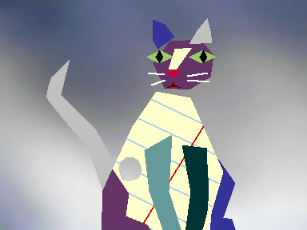
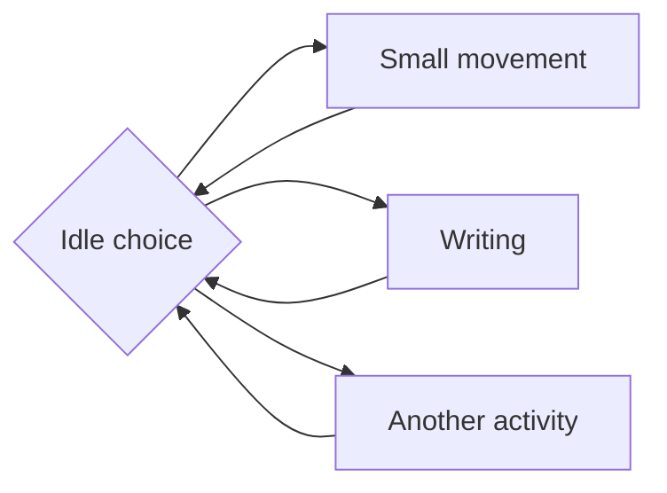

# Office Assistant Exporter

Export classic Microsoft Actor (`.ACT`) animations as MP4 videos, animated WebP files, PNG frames, and timing reports. Includes original sound effects in MP4, readable action names, and automatically assembled full idle showcases.

Built with AI assistance using OpenAI Codex for implementation, documentation, and validation work.

### Example: Will's short idle sample


A transparent animated WebP exported at 2× scale. This is the short idle sample; the full idle showcase is available when you export an actor. This example contains original character artwork; the repository's code license does not apply to it.

## Requirements

- **Windows PowerShell 5.1** and **.NET Framework 4.x**. The scripts use the Framework compiler; a .NET SDK is not required.
- **[Universal Character Scripting Helper (UCSH)](https://tmafe.com/ucsh)** for `FrontierUtopia.dll`.
- **[FFmpeg](https://ffmpeg.org/download.html)** available on your `PATH`, with H.264, AAC, and animated WebP encoding support. Validation also uses `ffprobe`.
- **`.ACT` character files**, also available from [TMAFE's classic Microsoft Actors collection](https://tmafe.com/classic-ms-actors). Microsoft Agent `.ACS` files are not supported.

UCSH, FFmpeg, and character files are not bundled.

## Quick start

With FFmpeg on your `PATH`, copy `FrontierUtopia.dll` from your [UCSH installation](https://tmafe.com/ucsh_latest.html) (usually `C:\Program Files (x86)\UCSH`) beside the scripts. Keep all `.cs` and `.ps1` files together, then open Windows PowerShell in that folder:

```powershell
.\Build-And-Export.ps1 -Actor 'C:\Actors\will.act' -Scale 2 -WebP -Output .\WillOutput
```

Replace the actor path with your own. The script builds automatically and saves MP4 and WebP files in `WillOutput`. Relative paths resolve beside the scripts.

## Export a whole folder

```powershell
.\Export-Actors.ps1 -ActorsDirectory 'C:\Actors' -Scale 2 -WebP -Output .\OfficeExports
```

Each `.ACT` file directly inside that folder gets its own output subfolder. Subfolders are not searched. `batch.csv` records each actor's result, dimensions, and any error. If one actor fails, the runner continues with the remaining actors and reports the failure at the end.

## Which files should I use?

| Output | Purpose |
| --- | --- |
| `001_idle_showcase.mp4` | Full idle repertoire, automatically assembled into one usable video. |
| `001_idle.mp4` | Short, repeatable sample of the original random idle behavior. |
| Other `###_characterSuccessMajor.mp4` files | Individual actions with sound effects. |
| Matching `.webp` files | Animated images with transparency by default; no audio. Requires `-WebP`. |
| Action subfolders | Source PNG frames, timing data, and playback reports. |
| `sounds/` | Original extracted WAV sound effects. |

Standard action names come from UCSH's `defaultactions.h`; unknown action IDs keep their numeric identifier.

## Common options

These options work with both the single-actor and folder scripts unless noted.

| Option | Behavior |
| --- | --- |
| `-Scale 2` | Render vector artwork at twice its original dimensions. Accepts 1–12. Default: 4 for a single actor, 2 for a folder. |
| `-ScaleBitmaps` | Apply the requested scale to bitmap, mixed, and unknown artwork too. Otherwise they stay at native size. |
| `-WebP` | Create animated WebP files alongside MP4. |
| `-NoMP4 -WebP` | Create WebP files without MP4. |
| `-NoMP4` | Export frames and reports without encoding videos. |
| `-Background '#E8E0D0'` | Fill transparent areas with a color. Accepts .NET color names, quoted `#RRGGBB`, or `Transparent`. |
| `-BackgroundImage 'C:\Images\desk.jpg'` | Add a background image, centered and cropped to fill the canvas without stretching. |
| `-Cycles 3` | Take an identified ending on the third loop pass when available. Accepts 0–10; default 3. |
| `-MaxLoopSeconds 10` | Set the sample budget for random cyclic actions. Default: 10 for a single actor, 3 for a folder. |
| `-Mode analyze` | Write analysis reports without rendering frames or encoding media. |
| `-Force` | Rebuild existing output. Use after changing an ACT file, DLL, or exporter source. |
| `-DebugVariants` | Also encode the separate idle variant videos used to assemble a showcase. |
| `-NoShowcase` | Skip the full idle showcase. Single-actor script only. |

### Scaling

Artwork detection examines the resources inside each actor. Pure vector artwork uses the requested scale; bitmap, mixed, or unknown artwork stays at its original size unless you use `-ScaleBitmaps`. For a 192×144 vector actor, `-Scale 2` produces 384×288 media.

The console and `artwork.csv` report the detected type and effective dimensions.

### Backgrounds and transparency

PNG frames and WebP files default to transparent backgrounds. MP4 uses a dark backing wherever pixels remain transparent.

```powershell
# Image background
.\Build-And-Export.ps1 -Actor 'C:\Actors\will.act' -Scale 2 -WebP -BackgroundImage 'C:\Images\desk.jpg'

# Solid color background
.\Build-And-Export.ps1 -Actor 'C:\Actors\will.act' -Scale 2 -WebP -Background '#E8E0D0'
```

You can combine a background image with a color: transparent parts of the image reveal that color. Background settings, image content hashes, and effective scale participate in output completion signatures.

### Example: Scribble with a background image



Scribble's short idle sample at 2× scale, with an Office-like background.

To export your own copy of Scribble with this background:

```powershell
.\Build-And-Export.ps1 -Actor 'C:\Actors\scribble.act' -Scale 2 -WebP -BackgroundImage .\docs\media\office97-background-smooth.png -Output .\ScribbleOutput
```

## Idle animations and loops

Idle animations randomly choose between different activities. A short sample can miss some of them, such as Will's writing animation. This simplified diagram shows the idea:



The exporter makes two versions:

- **`idle`**: a short, repeatable random sample.
- **`idle_showcase`**: the reachable idle branches played in a fixed order, assembled into one clip.

When branches cannot reconnect, the showcase joins separate sections with a brief rest pose and an action restart:


These resets can be visible. Separate variant movies are only produced with `-DebugVariants`.

Other finite actions play in full. Repeating actions use `-Cycles 3` by default and take an ending when available; the final cycle may be partial. Random samples use `-MaxLoopSeconds` and may run longer to finish an ending. `-Cycles 0` keeps one deterministic cycle or a bounded random sample. The full idle showcase is not time-capped.

## Audio and playback

- MP4 uses **H.264/AAC at 60 fps**, with a half-second final pose hold.
- Original sound effects are preserved as WAV files and scheduled on one sound channel: each new cue replaces the previous cue, and gaps are silent. The final cue may finish after the final animation frame.
- Speech synthesis is not generated. WebP has no audio track.
- `frames.csv` preserves source timing in integer milliseconds. MP4 timing is rounded to its 60 fps grid.
- WebP repeats the entire clip, including any intro and ending. It does not play an intro once and then repeat only an inner loop.

## Reports and validation

`actions.csv` indexes the exported actions. `analysis.csv` describes their instruction graphs and loop classifications. Each action also has frame, sound, instruction, opcode, and playback reports. Showcase coverage reports describe visited instructions and edges; assembled showcases include `segments.csv`, source-variant columns, and `assembly.txt` documenting the restarts.

To validate a folder export:

```powershell
.\Validate-Actors.ps1 -Output .\OfficeExports
```

Additional checks:

```powershell
.\Validate-Audio.ps1
.\Validate-Scaling.ps1 -Actors 'C:\Actors' -Render
.\Validate-Backgrounds.ps1 -Actor 'C:\Actors\will.act'
```

Validation checks instruction transitions, documented exit overrides, frame and sound timing, idle coverage, and media decoding. Assembled showcase sections are compared with their source variants and declared rest frames. Add `-DebugVariants` to `Validate-Actors.ps1` to require debug media checks too.

## Troubleshooting and limitations

- **Missing DLL:** copy `FrontierUtopia.dll` beside the scripts, rather than into the output folder.
- **FFmpeg not found:** ensure its executable folder is on `PATH`, then open a new PowerShell window.
- **Old results after changing inputs:** rerun with `-Force`. ACT, DLL, and source changes are not automatically detected by the completion cache.
- **Extra variant movies after upgrading:** use a new output folder for a clean export. Old files are not deleted automatically.
- **Unexpected bitmap dimensions:** native-size preservation is intentional. Use `-ScaleBitmaps` to override it.
- The exporter reads private FrontierUtopia fields, so compatibility can depend on the installed library version.
- The `ZVISIBLE` character identifies itself as Invisible and has no visible rendered pixels.

## Credits and license

Credit to **[Universal Character Scripting Helper (UCSH)](https://tmafe.com/ucsh)** and **Konnor88 / TMAFE**. The exporter uses the Frontier Actor library distributed with UCSH (`FrontierUtopia.dll`) to load and render ACT characters. Standard action names come from UCSH's `defaultactions.h`.

Get UCSH from its [official download page](https://tmafe.com/ucsh_latest.html).

The exporter code is covered by this repository's [BSD 3-Clause license](LICENSE). That license does not cover UCSH, Frontier Actor, FFmpeg, or original character artwork and sounds; those remain subject to their respective terms. This repository does not distribute the UCSH DLL or character assets.
